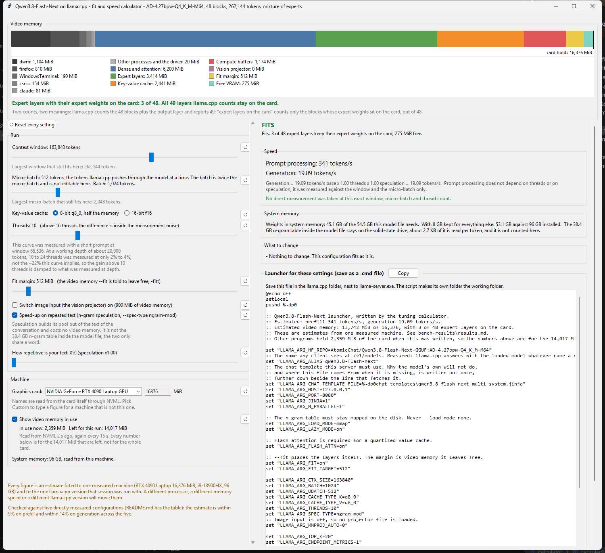

# llama.cpp fit and speed calculator — Qwen3.8-Flash-Next

A desktop calculator that estimates llama.cpp video memory, system memory and speed for one specific model. Move a slider, and every output updates while you drag. It also writes the launcher file that starts the server with those settings.



## TL;DR

Install `uv`, then run this:

```
uvx --from git+https://github.com/ALERTua/Qwen3.8-Flash-Next-calculator qwen-flash-calculator
```

Nothing else is installed, and nothing is cloned by hand. Move the sliders until the headline says `FITS`, press **Copy**, and save the text as a `.cmd` file in your llama.cpp folder, next to `llama-server.exe`. Run that file. It fetches the model, the chat template and, when image input is on, the projector, and then starts the server.

## Step by step

This is the whole run, from an empty folder to a server that answers.

1. Install `uv`. It is the only thing you install. It brings its own Python, so nothing else is needed.
2. Open a terminal in this folder, the one that holds `pyproject.toml`.
3. Run `uv run qwen-flash-calculator`. The window opens. The first run takes a few seconds while `uv` prepares its folder.
4. Pick your graphics card in the **Machine** block. The list holds the cards this machine has. Pick **Custom** to type a figure for a machine that is not this one.
5. Set the **context window** and the **micro-batch** at the top of the left column. These two decide almost everything else.
6. Read the headline on the right. It says `FITS`, `SPILLS TO THE PROCESSOR` or `DOES NOT START`. Only the first one is a healthy run.
7. If it does not fit, read the **What to change** panel. It lists the levers in order of the memory each one frees, largest first.
8. Press **Copy** beside the launcher box. The whole launcher text goes to the clipboard.
9. Save that text as a file whose name ends in `.cmd`, in your llama.cpp folder, next to `llama-server.exe`. The file only works from there, because it makes its own folder the working folder.
10. Run the file. The first run downloads what is missing and prints what it fetched. Later runs start at once.

Steps 2 and 3 have a shorter form when you do not have this folder at all. One line builds it from the repository and opens the window: `uvx --from git+https://github.com/ALERTua/Qwen3.8-Flash-Next-calculator qwen-flash-calculator`.

### What the first run downloads by itself

You fetch nothing by hand.

- The model. The launcher names the repository, and `llama-server` downloads it.
- The chat template. The launcher fetches it and prints the version that arrived. The template inside the model file refuses a system message that is not the first one, so a client that inserts one mid-conversation gets HTTP 500 in a retry loop. The fetched copy does not carry that rule.
- The image projector, 862 MiB, but only when image input is on. The download goes to a temporary name and is renamed after it finishes, so an interrupted run cannot leave a half file that looks whole.

You supply one thing: `llama-server.exe` itself, with the rest of llama.cpp around it.

If one of those downloads fails, the launcher stops instead of starting a server that would fail on the first request. It prints the address to fetch by hand and the name to save it under.

### Where the settings are kept

The window writes what you left set into `%APPDATA%\Qwen3.8-Flash-calculator.json` when you close it, and puts it back next time. If that file does not read back, or holds a value of the wrong kind, the window deletes it and opens on its defaults. Half the controls from an old file and half from the defaults is a state nobody can explain later.

Every control has a `↺` button beside it that puts that one control back. **Reset every setting**, at the top of the left column, does the lot.

## What it is for

The question this answers is always the same one: **how large a micro-batch still fits beside the window you want?** The
micro-batch is the number of tokens llama.cpp pushes through the model at a time; the batch is twice it and is not a
separate control here. Everything else follows from that. The calculator shows, live:

- **prompt processing**, the speed at which llama.cpp reads the text you send it, and **generation**, the speed at which
  it writes new tokens, both in tokens per second
- where the video memory goes: dense and attention weights, expert layers, key-value cache, compute buffers, the vision
  projector, the fit margin, and how much is free
- how many expert layers keep their expert weights on the card
- how much of the model file stays in system memory
- whether the configuration loads at all, and if not, which lever to reduce, largest saving first

### Two layer counts, two meanings

llama.cpp counts the 48 blocks plus the output layer and prints **49 layers**. "Expert layers on the card" counts
something else: the blocks whose expert weights sit on the card, **out of 48**. A run can have all 49 layers on the card
and only 4 expert layers, and that is the normal, healthy case. The calculator never mixes the two counts in one
sentence.

### Three states, and only three

| On screen                 | What it means                                                                                    |
|---------------------------|--------------------------------------------------------------------------------------------------|
| `FITS`                    | Everything llama.cpp wants is on the card, and generation follows the healthy curve              |
| `SPILLS TO THE PROCESSOR` | The run still starts, but `--fit` moved whole layers onto the processor and generation collapses |
| `DOES NOT START`          | The compute buffers alone do not fit beside the fit margin, so there is nothing to move          |

## How to run it

Every command runs from this folder, the one that holds `pyproject.toml`. From anywhere above it, `uv run` finds no project and the test command reports "NO TESTS RAN" while still exiting 0.

```
uv run qwen-flash-calculator                     open the window
uv run pytest                                    run the tests
uv run pre-commit run -a                         run every check
uv build                                         build a wheel into dist/
```

### Running it on a machine that has nothing

Nothing here is published to any package index. `uvx` does not need one: it builds whatever it is pointed at, and it can be pointed straight at the repository.

```
uvx --from git+https://github.com/ALERTua/Qwen3.8-Flash-Next-calculator qwen-flash-calculator
```

That is one line, on a machine that holds none of this. `uv` is the only thing that has to be there first.

The same works for a folder you already have:

```
uvx --from . qwen-flash-calculator
uvx --from C:\somewhere\_calculator qwen-flash-calculator
```

Either way, `uvx` keeps nothing on disk between runs except the settings file in `%APPDATA%`.

With a plain Python 3.11 or newer, install the folder first, then the same command works:

```
pip install .
qwen-flash-calculator
```

There is nothing to install beside it. The project declares no dependencies, and the interface is tkinter and ttk from the standard library. `uv run` writes a `.venv` folder next to `pyproject.toml`, which holds links to the interpreter and the project itself, and deleting it costs nothing.

## The model it describes

`AtomicChat/Qwen3.8-Flash-Next-GGUF`, model file (quant) `AD-4.27bpw-Q4_K_M-M64`: 48 blocks, native window 262,144
tokens, mixture of experts, 512 experts with 10 used. 36 of the 48 blocks use Gated DeltaNet with a recurrent state of
fixed size, and only 12 hold an ordinary key-value cache with 2 key-value heads each. That is why a long window is cheap
here.

The model file needs 54.5 GB of fast memory for dense weights plus experts. That figure is **published by the people who
built the quant; it was not measured here**.

Its 38.4 GB n-gram table stays mapped on the solid-state drive, about 2.7 KB of it is read per generated token, and it
is not counted anywhere in this calculator. **That table and n-gram speculation are two different things that share a
word.** The table is part of the model file and is always there. Speculation (`--spec-type ngram-mod`, the "speed-up on
repeated text" checkbox) builds its own pool out of the text of the conversation, costs no video memory, and does not
touch the table.

Throughout this file, "model file" or "quant" means the `AD-4.27bpw-Q4_K_M-M64` variant of the weights. "llama.cpp
version" means which llama.cpp the weights were run under. The word "build" is used for neither, because it used to be
used for both.

## Where the numbers came from

Every coefficient was measured in one benchmark session on 2026-09-17 and 2026-09-18, recorded in
`bench-results/results.md`. The machine was an RTX 4090 Laptop with 16,376 MiB of video memory, an i9-13900HX with 24
cores and 32 logical processors, and 95.8 GB of system memory, under Legion Balance Mode.

**Nothing in `measured.py` is invented.** Two figures in it are published by the people who built the model file rather
than measured here — the 54.5 GB of weights and the 38.4 GB n-gram table — and both say so where they appear.
`estimator.py` only combines those tables; it adds no coefficients of its own except the two anchored rules described
under "The spill to the processor" below.

### Video memory, MiB

```
dense_and_attention = 6200
per_expert_layer    = 1138
kv_cache            = 0.0149 * ctx_tokens          (q8_0)
kv_cache            = 0.0298 * ctx_tokens          (f16)
compute_buffers     = 0.000014 * min(ubatch, ctx_tokens) * ctx_tokens
vision_projector    = 900                          (only when vision is on)

free_for_experts = vram_total - fit_margin - dense_and_attention
                   - kv_cache - compute_buffers - vision
layers_on_gpu    = clamp(floor(free_for_experts / 1138), 0, 48)
```

Against the four printed `CUDA0` breakdowns from `results.md` section 7.2. The window and micro-batch columns of this
table and of the prompt-processing table below are token counts, printed without separators exactly as `results.md`
records them:

| Window | Micro-batch | Model MiB | Cache MiB | Compute MiB |                   Expert layers on the card | Weights and cache within 4%? |
|-------:|------------:|----------:|----------:|------------:|--------------------------------------------:|------------------------------|
| 163840 |        2048 |      7531 |      2407 |        4752 |                                           1 | yes                          |
| 262144 |        2048 |      4281 |      2828 |        7581 | 0, and 33 of the 49 layers llama.cpp counts | **no, and it cannot be**     |
| 163840 |         512 |     10593 |      2407 |        1188 |                                           4 | yes                          |
| 262144 |         512 |      8668 |      3784 |        1813 |                                           2 | yes                          |

So: **three of the four rows match within 4% on model weights and on key-value cache; the second row does not.** Its
printed model and cache figures are far smaller than the formula predicts because llama.cpp had already pushed sixteen
whole layers, attention included, onto the processor before it printed them — the figures describe a different
placement, not a different model. That row is checked against the anchored spill split instead, within 10%.

The compute-buffer figure matches within 4% on **all four** rows, the second one included, because the buffers are
allocated before any layer is moved. All four expert-layer counts come out exactly right at the default fit margin of
1,024 MiB.

### Why 54.5 GB and the coefficients disagree

`6200 + 48 * 1138` is 60,824 MiB, that is 59.4 GiB of weights if every expert layer sat on the card, against the 54.5 GB
published for the same model file. The two numbers come from different sources: the coefficients were fitted to what
llama.cpp reports as resident on the card, the 54.5 GB is the quant's own published size. Neither was changed to make
the other look better. For the system-memory line the published figure wins, and the subtraction is floored at zero, so
a card large enough to hold everything is told so in words rather than shown a negative number.

### Generation speed

```
base(L) = 16.87 tokens/s + 0.74 tokens/s per expert layer * L expert layers
```

measured at 10 threads and window 163,840 tokens, from the hand-made `-ncmoe` splits in `results.md` section 7.3. The
intercept is the `-ncmoe 48` run, so `base(0)` is a measurement, not an extrapolation.

**The line was fitted on four points only: 0, 1, 2 and 4 expert layers.** Above 4 it is kept exactly as it is — nothing
else was measured, and an invented curve would be worse than a marked straight one — but the answer is then labelled
**extrapolated**, on screen next to the number and as a flag on the `Estimate` object. The 24 GB and 48 GB card presets
put 12 and 33 expert layers on the card, so both show an extrapolated figure, not a confident one.

The thread factor comes from the twelve-point curve in section 6.3, normalised so that 10 threads gives exactly 1.00.
Between measured points it interpolates. **The curve starts at 4 threads**; below that the line runs down to zero at
zero threads and the answer is marked extrapolated, because holding the 4-thread value there would claim that one thread
is as fast as four. Above the last measured point the end value is held. Everything from 16 to 32 threads sits between
22.2 and 25.1 tokens per second with a 14% to 18% spread on the individual samples, so those values cannot really be
told apart — treat the top of the curve as flat, and the control says so.

**That curve was measured with a short, 370-token prompt, at window 65,536.** It does not hold at a working depth: at
about 20,000 tokens, going from 10 to 24 threads was measured at only 2% to 4%, not the roughly 22% this curve implies
for that same jump. The interface repeats this in one sentence under the thread slider (`measured.THREAD_DEPTH_CAVEAT`),
and it is the leading suspect for the largest miss in the validation table below.

The speed-up on repeated text (n-gram speculation, `--spec-type ngram-mod`) runs from 1.00 on text the model has not
seen to 2.9 on text it has. It is exposed as a "how repetitive is your text" slider from 0 to 100 percent, mapped
linearly, and it only applies when speculation is switched on. The measured extreme was 53.65 against 18.33 tokens per
second, but that test sent one identical prompt and got one identical continuation, which is the friendliest possible
case. Real work lands lower.

### Prompt-processing speed

Read off the 24-run grid in `results.md` section 8, interpolated linearly in the window and linearly in log2 of the
micro-batch.

**Outside the grid the line carries on with the slope of the nearest measured edge, and the answer is marked
extrapolated.** It used to hold the edge value instead, which made micro-batch 256 read 341 tokens/s at window 163,840
tokens — the 512 figure, 54% above the 222 tokens/s the table's own 512-to-1,024 slope gives. The extrapolated line is
floored at 1 token/s so that it can never reach zero or turn negative.

| Window | ub 512 | ub 1024 | ub 2048 | ub 4096 |
|-------:|-------:|--------:|--------:|--------:|
|  65536 |    323 |     453 |     575 |     700 |
|  98304 |    318 |     427 |     604 |     718 |
| 131072 |    346 |     463 |     573 |     696 |
| 163840 |    341 |     460 |     570 |     630 |
| 196608 |    322 |     442 |     574 |     608 |
| 262144 |    326 |     447 |     530 |     582 |

The grid covers micro-batch 512 to 4,096 tokens and window 65,536 to 262,144 tokens. Anything outside those two ranges
is extrapolated and says so.

A micro-batch larger than the window is not a configuration at all: llama.cpp never has more tokens in flight than the
window holds. The calculator clamps the micro-batch to the window, says so in one line under the headline, and estimates
the clamped configuration.

Prompt processing depends on the micro-batch and barely on the window. It is kept completely independent of the
generation estimate: in the collapsed lower-right cells prompt processing is still roughly as listed while generation
falls apart.

### The spill to the processor

When `free_for_experts` is negative the configuration is in trouble. llama.cpp does not refuse: with `--fit` it starts
pushing whole layers, attention included, onto the processor, and generation collapses. That is the
`SPILLS TO THE PROCESSOR` state — the run loads, so it is never reported as a failure to fit, and it is never a silent
clamp. In the code that state is the constant `E.DEGRADED`, whose value is the words on screen.

Both spill rules are anchored on the single measured run where this happened — window 262,144 tokens, micro-batch 2,048
tokens, fit margin 512 MiB, on the 16,376 MiB card — which kept 33 of the 49 layers llama.cpp counts and fell from 19.8
to 8.1 tokens per second:

- **layers**: linear from 49 at no shortfall down to 33 at the reference shortfall, and on down to zero past it
- **generation**: the slowdown factor grows in proportion to the shortfall, from 1.0 at no shortfall to 16.87 / 8.1 at
  the reference shortfall

The reference shortfall is computed from the coefficients, not hard-coded, so it stays consistent if a coefficient is
ever corrected.

Checked against the generation half of the whole 24-run grid **at the 512 MiB margin the grid was measured with**, this
reproduces 22 of the 24 cells within 15% and most within 8%. Two cells miss, and `test_estimator.py` records both rather
than hiding them:

- **Window 131,072 with micro-batch 4,096**: the formula still finds 195 MiB free and calls it healthy, while the real
  run collapsed to 10.54 tokens per second. This is the one place the calculator is optimistic.
- **Window 262,144 with micro-batch 4,096**: the anchored straight line keeps steepening past the point it was fitted
  to, so the far corner comes out at about 2.5 against a measured 4.12. That is the safe direction for a fit calculator.

The window opens at the **1,024 MiB** fit margin, not at 512 MiB, so the same grid is checked there too. At the default
margin **three** cells miss by more than 15%, and each is asserted at the tolerance it actually needs:

|  Window | Micro-batch | Measured | Model | Off by |
|--------:|------------:|---------:|------:|-------:|
| 262,144 |       2,048 |     8.29 |  7.04 |  15.1% |
| 131,072 |       4,096 |    10.54 | 14.11 |  33.9% |
| 262,144 |       4,096 |     4.12 |  2.40 |  41.7% |

Every other cell is within 11% at that margin. The first row is the anchor run itself, measured at the other margin; the
second is the optimistic cell again, now spilling but not far enough; the third is the far corner.

The spill split of the card between dense weights and key-value cache uses the same anchored layer fraction. It lands
within 10% of the printed breakdown, not within 4% — it is a wider approximation than the healthy formula and is
labelled as such in the tests.

### When a run does not start

With `--fit` llama.cpp would rather move layers than fail, so a run only truly refuses to start when nothing is left on
the card after the fit margin, the vision projector and the compute buffers. At window 262,144 tokens with micro-batch
8,192 tokens the compute buffers alone want 30,065 MiB, which no 16 GB card can give.

Fixed splits fail much earlier. `-ncmoe 44` at window 163,840 tokens, and `-ncmoe 48` at window 262,144 tokens with
micro-batch 2,048 tokens, both gave `failed to create_context` on the real machine. This calculator models the `--fit`
behaviour, not a fixed `-ncmoe`.

### System memory

The published 54.5 GB of weights minus whatever sits on the card, **floored at zero**, plus any key-value cache that got
pushed off the card, which is counted and named apart from the weights. The calculator warns when the total plus 8 GB of
headroom for everything else is more than the machine has. When the card holds every weight, the panel says so in words
instead of printing a figure that cannot happen.

## Validation against direct measurement

Everything above is a model, fitted piece by piece to grids and hand-made splits. After it was built, **five whole
configurations were measured end to end**, on this same machine, to see how far the model actually lands from a real
run. All five share cache `q8_0`, `--fit on`, fit margin 1,024 MiB, speculation off, vision off. They are never fitted
to — `measured.VALIDATION_POINTS` says so where the table lives — and they are never interpolated: the calculator only
ever reports a comparison when the sliders land exactly on one of the five.

|  Window | Micro-batch | Threads | Measured prefill | Estimated prefill | Off by | Measured generation | Estimated generation |   Off by | Results folder |
|--------:|------------:|--------:|-----------------:|------------------:|-------:|--------------------:|---------------------:|---------:|----------------|
|  65,536 |       4,096 |      24 |              741 |               700 |    -6% |               23.43 |                23.28 |      -1% | `final`        |
| 131,072 |       2,048 |      24 |              525 |               573 |    +9% |               20.42 |                23.28 | **+14%** | `ctx130`       |
| 131,072 |       1,024 |      24 |              431 |               463 |    +7% |               21.53 |                24.18 |     +12% | `ctx130`       |
| 262,144 |         512 |      24 |              328 |               326 |    -1% |               23.47 |                22.38 |      -5% | `final`        |
| 262,144 |         512 |      10 |              326 |               326 |     0% |               19.84 |                18.35 |      -8% | `grid`         |

Across the five, the estimate is **within 9% on prefill and within 14% on generation**. `test_estimator.py` reproduces
every row rather than trusting these percentages, each at the tolerance that row actually needs.

**The largest miss is at window 131,072, micro-batch 2,048, where the estimate reads 14% high on generation** (and the
neighbouring 131,072/1,024 row misses almost as badly, at 12%). The likely reason is the thread curve described above:
it was measured with a short prompt at window 65,536, and at a working depth of about 20,000 tokens the real gain from
10 to 24 threads was only 2% to 4%, not the ~22% the curve says. Both 131,072 rows carry that same overstated thread
gain into their generation estimate, which is why they miss the most while the two 262,144 rows — carrying a different,
but smaller, error from the expert-layer line instead — stay closer to the measurement.

## The fit margin

The safety margin is called the **fit margin** everywhere in this project, in the code and on screen. `--fit` is the
llama.cpp switch that lets it place layers itself instead of failing; `-fitt` is the video memory, in MiB, that it is
told to leave free while doing so. That is the fit margin.

The interface defaults to **1,024 MiB**, which is what `results.md` section 7.4 recommends for a machine that also runs
a browser and an editor: the same speed as 512, with 1,247 MiB free against 951 MiB. **That 296 MiB is a measured
difference in free memory, not the 512 MiB difference between the two margins** — the fitter re-places the layers, so
the free memory does not move one for one with the margin. Three CUDA failures during the measurement session came from
the card sitting at 97% full while the desktop took more memory.

The 24-run grid itself was measured with `-fitt 512`, so that is the margin the spill anchor belongs to. Both constants
live side by side in `measured.py` as `DEFAULT_FIT_MARGIN_MIB` and `REFERENCE_FIT_MARGIN_MIB`.

## How the levers constrain each other

Nothing is ever clamped behind your back, with one exception that is announced in words: a micro-batch larger than the
window, which llama.cpp cannot use. A slider keeps whatever you set it to, and the line underneath tells you what the
card can actually hold — "Largest micro-batch that still fits here: 512 tokens" — turning red once you have gone past
it. The status line then reads `FITS`, `SPILLS TO THE PROCESSOR` or `DOES NOT START`, and the "What to change" panel
lists the levers **in order of the memory each one frees, largest first**, with that figure on every line. Image input
is offered as a lever only when switching it off actually changes the state.

The video-memory field is in **MiB**, and it holds what the card really reports rather than a round number: this card answers 16,376 MiB, not 16,384.

## What the window asks you, and what it reads itself

The **graphics card** is two controls side by side: a list of names and a field of MiB. The names come from the cards in this machine, read through NVML. Choosing one fills the field and locks it, because the card's size is a fact, not a preference. The last entry in the list is **Custom**, and it unlocks the field so you can type the size of a machine that is not this one. On a machine where no NVIDIA card answers, Custom is the only entry and the field starts at the reference card's 16,376 MiB.

**System memory** is not asked at all: Windows answers it in microseconds and the window prints what it found.

The launcher text sits under "What to change", at the foot of the results column, because it
is what the rest of that column adds up to.

The three measured configurations that used to be buttons here are gone from the window. They
are still in `measured.py` as `CONFIG_PRESETS`, still checked by the tests, and still written
out in results.md and comparison.md.

## How the window is laid out

The bar is the first thing in the window, across the whole width of it, with nothing above it
that can move it. The notes about what the numbers are worth sit **under** it: two of those
labels wrap, so their height changes with the width of the window, and while they were above
the bar every resize pushed the bar down the screen.

The name of the thing is in the title bar, where a title belongs, instead of costing a line
of height inside the window.

Both columns scroll, each on its own, with the wheel or its own scrollbar. The parameter
column is capped at 600 pixels wide and its text wraps at that width; before the cap it grew
to its longest caption, about 900 pixels, and took that room from the results. The launcher
panel inside the results column is capped at 800 pixels tall, because a text widget with no
ceiling grows to the length of the script and pushes everything above it out of reach.

## Reading the card while you work

Tick **Show video memory in use** under Machine. A block appears with the memory
other programs hold right now, the window reads the card again every 15 seconds, and every
number on the screen is recomputed against what is left rather than against the size of the
card. The bar gains a segment at its left edge for that memory, so the bar still adds up to
the whole card.

This matters because the card is never empty. A browser, a monitoring tool and the desktop
itself take between 700 and 1,600 MiB on the reference machine, and 2,048 MiB of those is one
expert layer that will not fit.

**How the number is read.** No `nvidia-smi` process and no administrator rights, on purpose.
The first way is NVML, `nvml.dll`, which the driver installs into `C:\Windows\System32`;
`nvidia-smi` is only a program that calls it. Measured 2026-09-18: 30 ms for a reading,
2,108 MiB in use of 16,376. The second way, used when that library is absent, is the Windows
performance counter `\GPU Adapter Memory(*)\Dedicated Usage`, which works for any make of
card. Measured the same day: 1,759 MiB, and two seconds per reading. The two disagree because
they count different things, so the block names the source that produced its number.

Two seconds is why the reading happens on a worker thread. The window itself never waits: the
worker leaves its answer in a queue and the window picks it up on its own thread, because
tkinter may only be called from the thread that created it.

**Who is holding it.** The bar names the five largest processes and adds everything else
together. Measured on the reference machine: `dwm` 1,418 MiB, `firefox` 1,002 MiB, `csrss`
143 MiB, `explorer` 81 MiB. The compositor is usually the largest single holder, and that is
not a fault: it keeps a buffer for every visible window at the size of the monitor, so a
5120x1440 desktop costs it more than a laptop panel does. Measured by opening one 5000x1400
window and watching the counter: +98 MiB for that one window, released when it closed.

The breakdown comes from a third counter set, `\GPU Process Memory(*)\Dedicated Usage`, the
one behind Task Manager's "Dedicated GPU memory" column. It costs 1.3 s and no administrator
rights. The total stays NVML's, because that is what the card really holds; the difference
between the two sources lands in the block named "Other processes and the driver".

**What it cannot do.** Split the figure per process through NVML. Under the Windows display driver model
NVML answers "not supported" for every process's memory; measured, 36 processes listed and not
one memory figure among them. Process *names* do come through, so when llama-server is one of
the processes on the card the block says so in orange: that reading already contains the model,
and the estimate below it is then answering a different question from the one you are asking.
Stop the server for a true reading.

## The files

| File | What it holds |
|---|---|
| `src/qwen_flash_calculator/app.py` | Entry point and the whole tkinter interface, including the stacked video-memory bar drawn on a Canvas |
| `src/qwen_flash_calculator/estimator.py` | The estimation model, `Config` in and `Estimate` out, and the text of the `.cmd` launcher. No interface code |
| `src/qwen_flash_calculator/measured.py` | Every measured table and coefficient, as data. No logic. Also holds `VALIDATION_POINTS`, the five direct measurements, and `CONFIG_PRESETS`, the three shipped profiles |
| `src/qwen_flash_calculator/vram.py` | Reads the video memory in use, without `nvidia-smi` and without administrator rights. NVML first, the Windows GPU performance counter as the fallback |
| `tests/test_estimator.py` | 89 checks on the numbers: the four breakdowns, the prompt-processing grid inside and outside its edges, the thread curve, the speculation multiplier, the anchored spill, the whole 24-cell generation grid at both fit margins, the failure cases, the system-memory rules and the five validation points |
| `tests/test_launcher.py` | 34 checks on the `.cmd` text: every flag and environment line, the chat-template fetch and the projector fetch, including the failure paths |
| `tests/test_vram.py` | 14 checks on reading the card and on naming the processes that hold it |
| `tests/test_window.py` | 80 checks that build the window itself under a withdrawn root: the bar, the legend, the wording, the scrolling columns, the card picker, the reset buttons and the settings file |

Together the four test files hold 217 checks, and `uv run pytest` runs them all. They are pytest tests: plain classes, plain `assert`, no `unittest.TestCase`.

## A warning worth repeating

Every figure here is an estimate fitted to **one** measured machine and **one** llama.cpp version. A different
processor, a different memory speed or a different llama.cpp version will move them. The shape of the answer — that the
micro-batch is the lever that decides whether the layers stay on the card — is the part that transfers; the exact tokens
per second is not.
